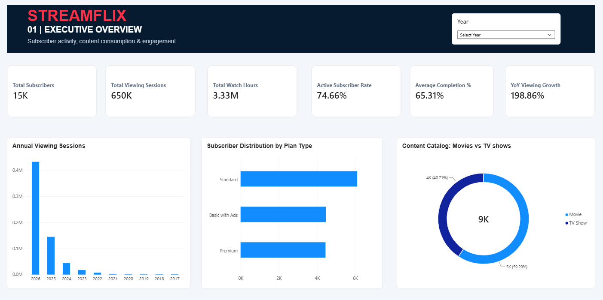
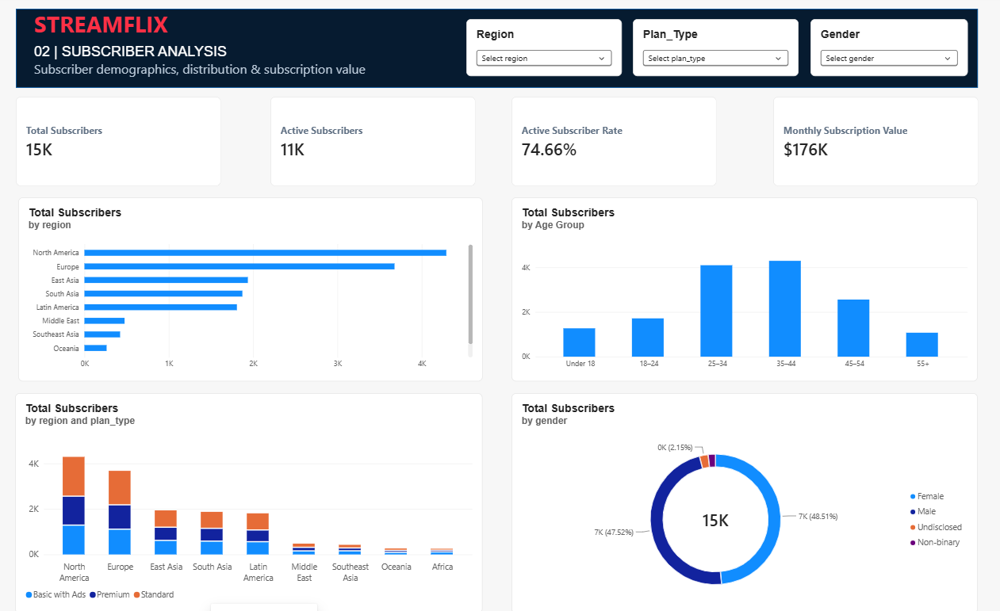
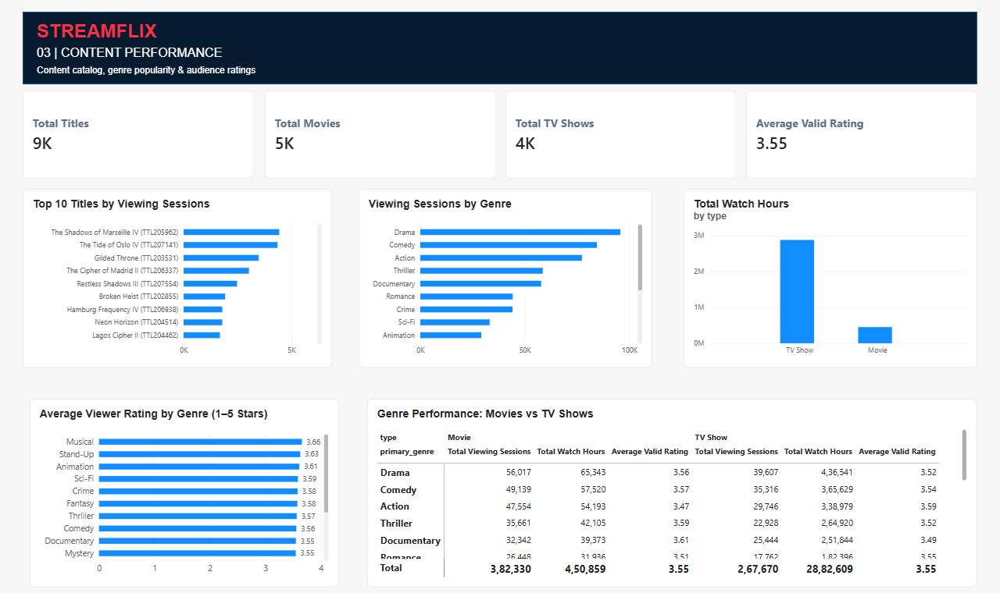
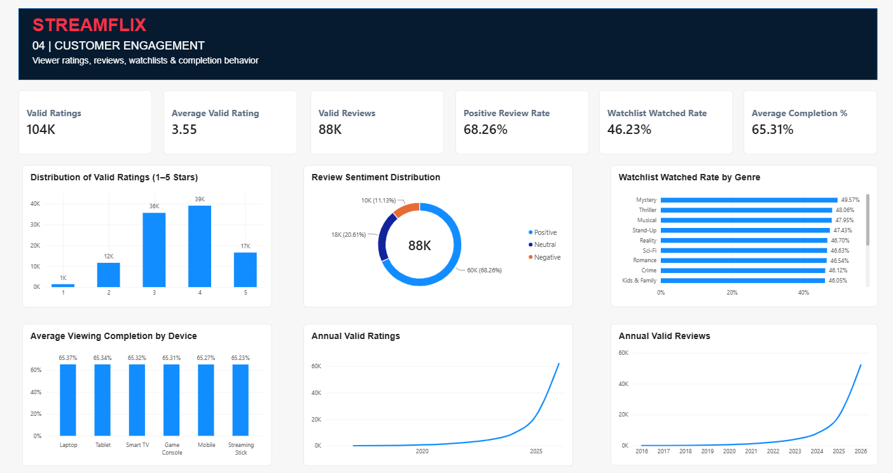

# StreamFlix | Streaming Analytics Dashboard

**End-to-end Data Analytics Portfolio Project**  
**Tools:** Python (Pandas), Power BI, Power Query, DAX  
**Data:** Synthetic streaming-platform datasets (not real customer records)

## Project overview

StreamFlix is a portfolio analysis of subscriber activity, viewing behavior, content performance, and customer engagement. The project brings together six related datasets, cleans and validates them, builds a relational Power BI model, and presents insights through four report pages.

## Business questions

- How active is the subscriber base, and which plans and demographics are most represented?
- Which genres and titles attract viewing sessions and watch hours?
- How do movies and TV shows compare in consumption and ratings?
- What do ratings, reviews, watchlists, and completion metrics reveal about engagement?

## Dataset and model

| Dataset | Approximate records | Role |
|---|---:|---|
| Subscribers | 15,000 | Subscriber demographics and subscription plans |
| Titles | 9,000 | Content catalog |
| Watch history | 650,000 | Viewing activity |
| Ratings | 129,800 | Submitted ratings |
| Reviews | 109,829 | Submitted reviews |
| Watchlist | 64,939 | Saved titles and watched status |

The Power BI model connects subscriber and title dimensions to activity tables and uses a date table for time-based analysis. The model was reviewed for relationship consistency.

## Dashboard pages

1. **Executive Overview:** subscribers, viewing sessions, watch hours, active rate, completion rate, annual viewing activity, plan mix, and content catalog.
2. **Subscriber Analysis:** subscriber demographics, region, age, gender, plan type, and estimated monthly subscription value.
3. **Content Performance:** content catalog, top titles, viewing sessions by genre, watch hours by type, ratings, and a genre comparison matrix.
4. **Customer Engagement:** valid ratings and reviews, review sentiment, watchlist watched rate, viewing completion by device, and annual feedback trends.

## Selected KPIs

| Metric | Dashboard value |
|---|---:|
| Total subscribers | 15K |
| Active subscriber rate | 74.66% |
| Viewing sessions | 650K |
| Total watch hours | 3.33M |
| Average completion | 65.31% |
| Total titles | ~9K |
| Average valid rating | 3.55 / 5 |
| Positive review rate | 68.26% |
| Watchlist watched rate | 46.23% |
| Estimated monthly subscription value | ~$176K |

## Key findings

- Approximately **one in four subscribers is inactive**, suggesting an opportunity to investigate reactivation strategies.
- **North America** has the largest subscriber count; **ages 35–44** form the largest age segment, and **Standard** is the most common subscription plan.
- **TV shows contribute substantially more watch hours than movies** (approximately 2.88M versus 0.45M). Longer episodic runtimes should be considered before interpreting this as greater popularity.
- Average viewing completion is **65.31%**, motivating further comparison by device, content type, and genre.
- Review sentiment is predominantly positive among the valid reviews, but review and rating eligibility rules affect the denominator.

## Data preparation and quality

The workflow included Python/Pandas cleaning, handling duplicates and missing values, date and key validation, and preparing cleaned CSV tables for Power BI. A separate technical audit documented **25 data-quality checks**. Known exceptions included:

- Approximately **25.8K ratings** dated before subscriber signup.
- Approximately **22.1K reviews** dated before subscriber signup.
- Approximately **1,966 titles** with missing license expiry dates.

The project uses **valid ratings/reviews** measures to exclude feedback dated before signup. These issues are documented rather than silently treated as clean data.

## Important limitations

- The dataset is **synthetic**; findings illustrate analytics methods rather than real StreamFlix business performance.
- **2026 is a partial year** in the project data. Year-over-year comparisons need aligned date windows; an all-years YoY KPI should not be presented as a current-year growth claim.
- **Estimated monthly subscription value is not actual collected revenue** and does not account for payment failures, discounts, or refunds.
- Watchlist watched status does not independently prove the viewing happened after the title was added.
- Approximately 3.33M watch hours across 650K sessions implies a high average duration; session-length outliers warrant further review.

## Repository contents

```text
StreamFlix-Streaming-Analytics/
├── README.md
├── StreamFlix_Analytics.pbix
├── StreamFlix_Dashboard.pdf
└── screenshots/
    ├── executive_overview.png
    ├── subscriber_analysis.png
    ├── content_performance.png
    └── customer_engagement.png
```

*Python scripts are not included in the initial release. They may be added later after recovering and verifying the original code.*

## How to explore

1. Open `StreamFlix_Dashboard.pdf` for a four-page static overview.
2. Open `StreamFlix_Analytics.pbix` in Power BI Desktop for the interactive report (Power BI Desktop and compatible data access may be required).
3. Use the report slicers to explore the relevant subscriber and content segments.

## Skills demonstrated

Data cleaning and validation · Relational data modeling · Power Query · DAX measures · KPI design · Power BI dashboards · Business insights · Data-quality documentation

## Power BI Dashboard Preview

### 01 — Executive Overview


### 02 — Subscriber Analysis


### 03 — Content Performance


## Project Files

- `StreamFlix_Analytics.pbix` — Power BI dashboard
- `StreamFlix_Dashboard.pdf` — PDF dashboard export
- `screenshots/` — Four dashboard screenshots
- `README.md` — Project documentation

### 04 — Customer Engagement

